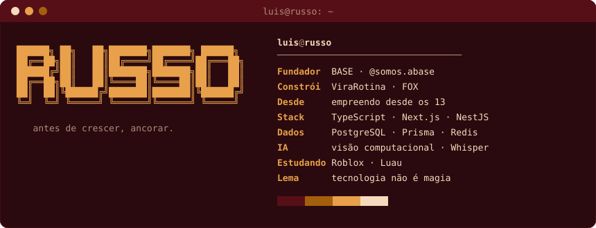
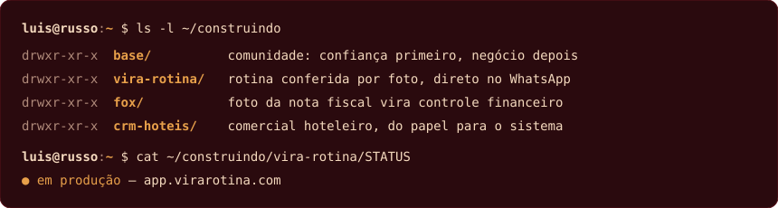

<h3><code>luis@github ~ $ ./boot.sh</code></h3>

  

<h3><code>luis@github ~ $ whoami</code></h3>

  

<h3><code>luis@github ~ $ ls ~/construindo</code></h3>

  

<h3><code>luis@github ~ $ cat stack.txt</code></h3>

  
  
  
  
  
  
  
  

 

<h3><code>luis@github ~ $ ./contato.sh</code></h3>

  
  
  
  

